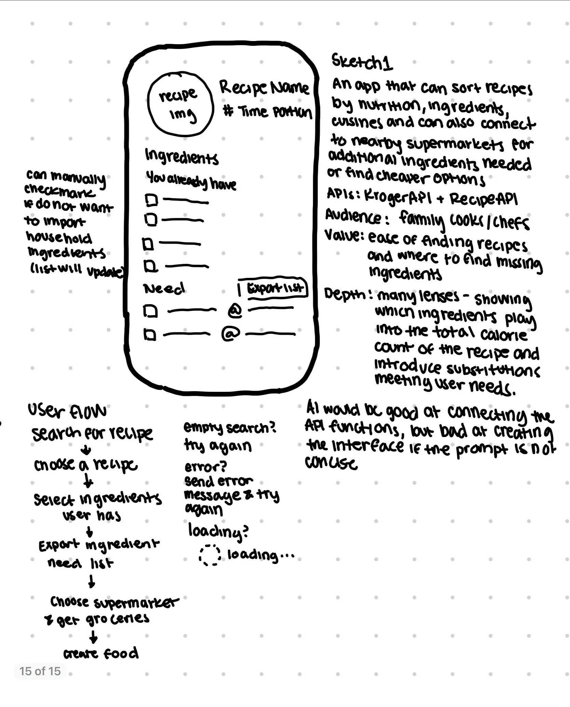

### Concept 1 ###

All information needed for concept is in the image.

### Concept 2 ###

All information needed for concept is in the image.

### Concept 3 ###

All information needed for concept is in the image.