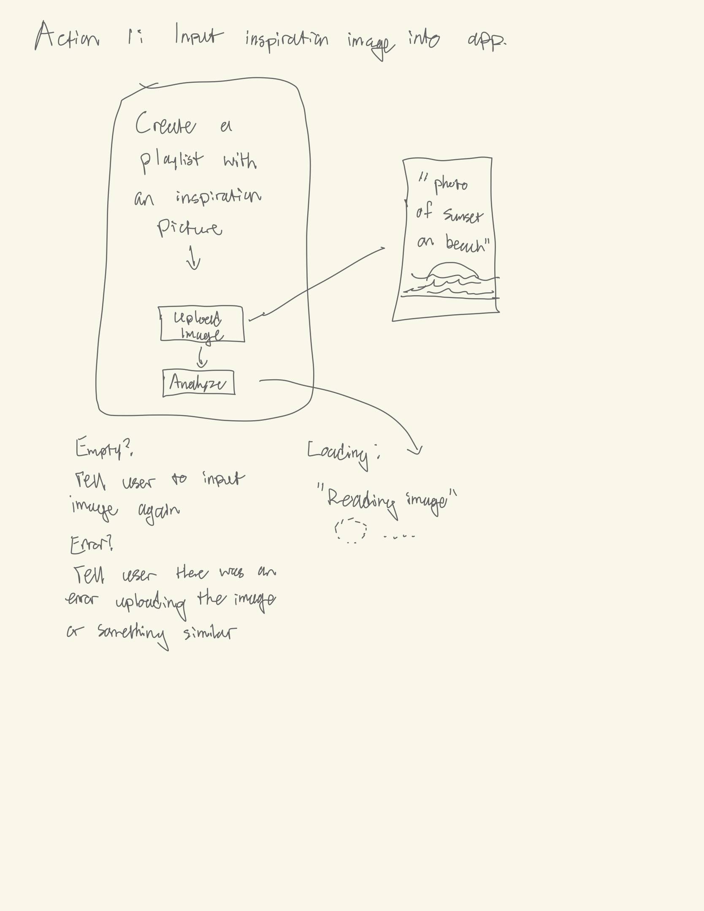
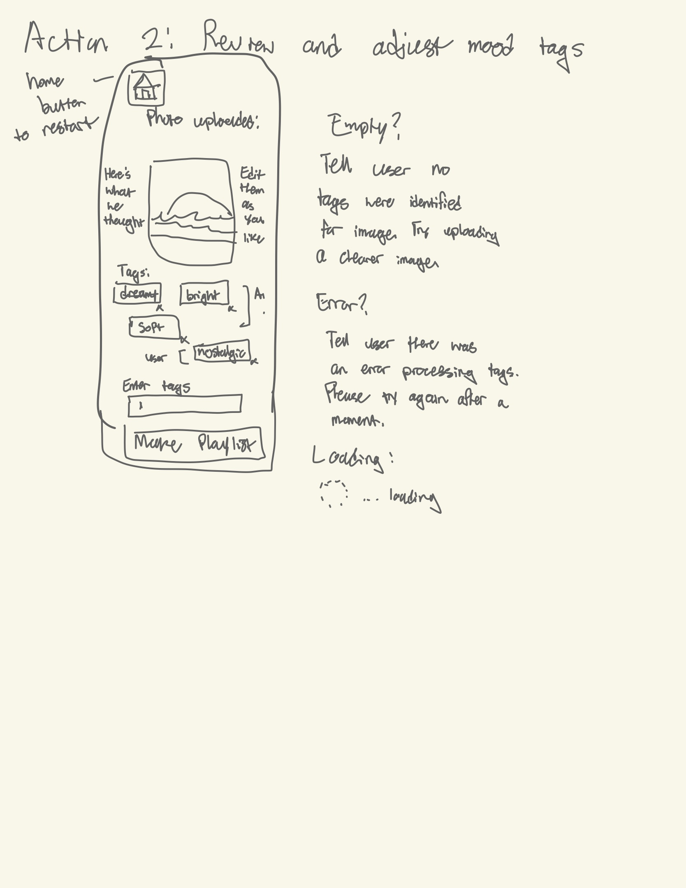
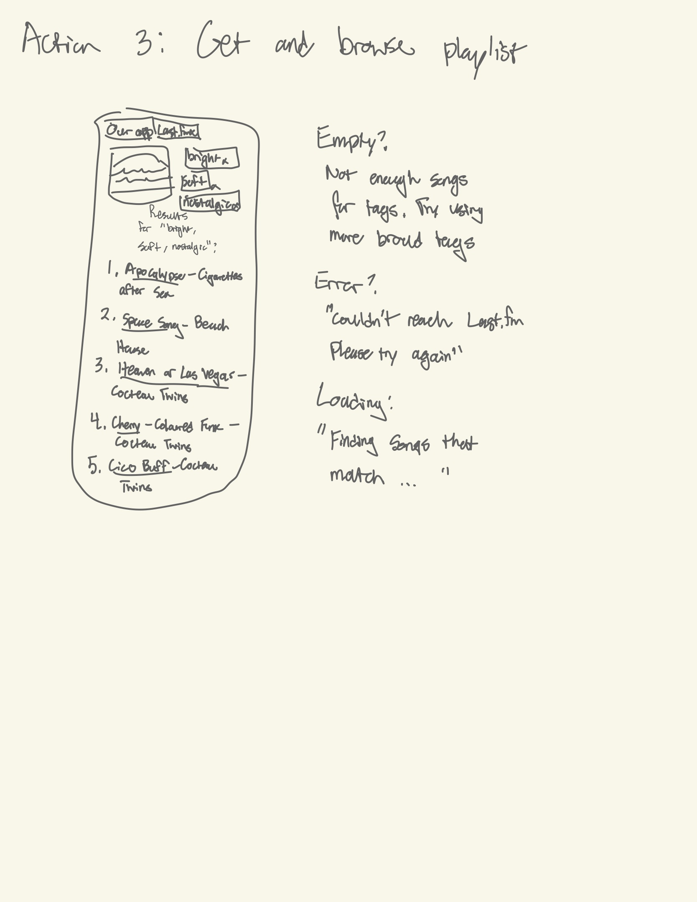

### Design Problem, Audience, & Value ###
Our app is designed for music listeners who want to discover new songs that match a specific mood or aesthetic but struggle to find the right music through traditional search and recommendation platforms. Users can upload an inspiration image, such as a Pinterest photo or mood board, and receive a curated playlist that reflects its overall vibe, atmosphere, and emotions. Unlike Spotify or Last.fm, which primarily recommend music based on listening history, genres, or similar artists, our app uses visual inspiration to create a more personalized music discovery experience. By integrating the Google Gemini API for image analysis and the Last.fm API for song recommendations, our app helps users discover music that matches the aesthetic they're looking for without having to describe it in words.

### Depth Item ###
Our app uses the AI step with a human check depth item by allowing users to upload an inspirational image and receive a playlist based on its mood and aesthetic. Using the Google Gemini API, the app analyzes the image and generates descriptive mood tags, which are then used with the Last.fm API to recommend songs. Before generating the playlist, users can review and adjust the AI-generated mood tags to ensure the recommendations match the vibe they're looking for.

### Main User Flow ###
## TODO!
Action 1: Input inspiration image into app
| Step | The user...  | The app.. | They see... | 
| -------- | -------- | -------- | -------- | 
| 1 | clicks "Upload image" and picks photo of sunset | checks the file is an image (JPG or PNG) and if it's too big or not| A screen showing their picture and an "Analyze" button |
| 2 | clicks Analyze | sends picture to Gemini API and asks for 3-6 mood tags | "Reading image" with a loading spinner |
| 3 | waits for result | gets the tags back from the API | tags the image with the moods

Action 2: Review and adjust mood tags
| Step | The user...  | The app.. | They see... | 
| -------- | -------- | -------- | -------- | 
| 1 | reads the mood tags generated | marks them as given by Gemini API | A screen showing the tags and a message saying "here's what we thought. Edit them as you like" |
| 2 | clicks x on "dreamy" tag | removes the tag | remaining tags |
| 3 | types in "nostalgic" and presses Enter | adds tag and labels it as added by user | a new tag styled differently so they know they added it
| 4 | clicks "Make playlist" | locks the tag list | loading spinner|

Action 3: Get and browse playlist
| Step | The user...  | The app.. | They see... | 
| -------- | -------- | -------- | -------- | 
| 1 | waits after clicking "Make playlist" | calls Last.fm API and gets the top tracks for each tag | "Finding songs that match" |
| 2 | scrolls results | shows at least 5 songs | a list with songs each with the matching tag|
| 3 | clicks a song | opens the songs Last.fm page | the songs Last.fm page in a new tab

### Data Sources ###
## Last.fm API
Name and Docs Link: Last.fm API https://www.last.fm/api

What we use it for: After users upload an inspiration image, the Google Gemini API will analyze the image and identify its mood and aesthetic. We will then use the Last.fm API to search for songs associated with those mood and genre tags and generate a curated playlist.

API Key: Required. Developers must register for a Last.fm API account to obtain a key.

Rate Limits: Last.fm applies API usage restrictions, but a specific universal request limit is not clearly published.

Cost: Free API access, subject to Last.fm's terms and usage restrictions.

Sample API Call [ AI ]:

import os
import json
from pathlib import Path
import requests
from dotenv import load_dotenv

# STEP 1: Find .env in the current folder or parent folders
env_path = None

for folder in [Path.cwd(), *Path.cwd().parents]:
    candidate = folder / ".env"
    if candidate.is_file():
        env_path = candidate
        break

# If not found, ask for the location
if env_path is None:
    print("Could not automatically find your .env file.")
    file_location = input(
        "Enter the FULL path to your .env file: "
    ).strip().strip('"').strip("'")
    env_path = Path(file_location).expanduser()

if not env_path.is_file():
    raise FileNotFoundError(f".env file not found: {env_path}")

# STEP 2: Load API key
load_dotenv(dotenv_path=env_path, override=True)

API_KEY = os.getenv("LastFmKey")

if not API_KEY:
    raise ValueError(
        "LastFmKey not found in your .env file. "
        "Check that it says LastFmKey=your_key"
    )

print("API key loaded successfully!")

# STEP 3: Last.fm API request
url = "https://ws.audioscrobbler.com/2.0/"

params = {
    "method": "tag.getTopTracks",
    "tag": "dream pop",
    "api_key": API_KEY,
    "format": "json",
    "limit": 5
}

print("\nSearching for dream pop songs...\n")

# STEP 4: Make live request
response = requests.get(url, params=params, timeout=15)
response.raise_for_status()

data = response.json()

if "error" in data:
    raise RuntimeError(data.get("message", "Last.fm API error"))

# STEP 5: Extract song information
songs = []

for track in data.get("tracks", {}).get("track", []):
    songs.append({
        "name": track.get("name"),
        "artist": track.get("artist", {}).get("name"),
        "url": track.get("url")
    })

# STEP 6: Print JSON response
print("LAST.FM API RESPONSE:")
print(json.dumps({"songs": songs}, indent=2))

Response:
API key loaded successfully!

Searching for dream pop songs...

LAST.FM API RESPONSE:
{
  "songs": [
    {
      "name": "Apocalypse",
      "artist": "Cigarettes After Sex",
      "url": "https://www.last.fm/music/Cigarettes+After+Sex/_/Apocalypse"
    },
    {
      "name": "Space Song",
      "artist": "Beach House",
      "url": "https://www.last.fm/music/Beach+House/_/Space+Song"
    },
    {
      "name": "Heaven or Las Vegas",
      "artist": "Cocteau Twins",
      "url": "https://www.last.fm/music/Cocteau+Twins/_/Heaven+or+Las+Vegas"
    },
    {
      "name": "Cherry-Coloured Funk",
      "artist": "Cocteau Twins",
      "url": "https://www.last.fm/music/Cocteau+Twins/_/Cherry-Coloured+Funk"
    },
    {
      "name": "Cico Buff",
      "artist": "Cocteau Twins",
      "url": "https://www.last.fm/music/Cocteau+Twins/_/Cico+Buff"
    }
  ]
}

What we noticed or found surprising: 
Last.FM API has tags for different types of music and that would be what we use to identify which songs have similar vibes.

## Google Gemini API
Name and Docs Link: Gemini API https://aistudio.google.com/docs

What we use it for: After users upload an inspiration image, the Google Gemini API will analyze the image and identify its mood and aesthetic. 

API Key: Required. Developers must register for with a Google account and get the key through Google AI Studio.

Rate Limits: Google applies rate limits by project and measures them across three dimensions: Requests per minute, Tokens per minute, and Requests per day. The free tier only has access to certain models and limits depend on which model it is.

Cost: Free API access but only for some models. 

Sample API Call [used AI]: 
[Sample Gemini API Call](gemini_api_test_code.py)

What I ran: 
python gemini_api_test_code.py foggy_beach.webp

Output:

Reading image: foggy_beach.webp (image/webp)
Sending image to Gemini (gemini-3.5-flash)...
Response received. Cleaning up tags...
Done!

{
  "tags": [
    "ambient",
    "atmospheric",
    "chill",
    "dream pop",
    "melancholic"
  ]
}
### Data Model ###

| Noun| What it holds | Saved? Why? |
| -------- | -------- | -------- | 
| image | file_name("foggy_beach.jpg), mime_type("image/jpeg"), image_bytes | No because we only use it to send to Gemini for the tags | 
| Mood tags | name ("dream pop"), source ("ai/user"), selected (boolean) | No, Gemini generates the tags and the user edits them before playlist is made. | 
| Song | name("Apocalypse"), artist("Cigerrates After Sex"), url(Last.fm link), matched_tag ("dreamy") | Yes in tags.json to speed up repeated searches and saves Last.fm calls to reduce token usage. | 
| Playlist | id , created_at, image_name, tags (list of tags), songs (list of songs) | Yes, in playlists.json so users can look at all the playlists that they've made. | 

How they relate: An image has multiple mood tags (Gemini gives 3-6). A mood tag finds multiple songs. A playlist is made from an image. One song can match multiple tags. 

### Tech Plan ###
| Route| Receives | Calls | Shows|
| -------- | -------- | -------- | -------- | 
| / | nothing | nothing | the upload box ("Drop your inspiration image here") 
| /tags | an image file (e.g. "foggy_beach.jpg") | Gemini | the image's mood tags as JSON which the page makes editable 
| /playlist | the user's final list of tags (after they revised)  | Last.fm | the songs as JSON (matching tags to songs) with no duplicates
| /playlists | nohting | nothing  | user's playlists that are saved |

| File | What it does |
| -------- | -------- | 
| app.py | the routes | 
| gemini.py | sends the images and prompt to Gemini and returns only tags |
| lastfm.py | asks Last.fm API for songs for each tag and keeps only the name, artist, and url. | 
| tags.json | saved Last.fm results grouped by tags |
| playlists.json | user's saved playlists from previous inputs |
| templates/index.html | the page with the upload box, image preview, mood tags and playlist |
| static/app.js | sends image to /tags, shows the mood tags, handles removing and adding tags, sends final tags to /playlist route, and shows loading, empty, and error messages |
| static/style.css | styling of the app |
| .env | we have our own keys on our own computers (not show in github) | 

Our depth item does not need a computer that stays on because it only runs when a user inputs an image. 

### Testing Audience ###
We plan to test our app with three University of Washington students who regularly listen to music and enjoy discovering new songs.
- UW student who frequently listens to music
- UW student interested in aesthetics and mood boards
- UW student who enjoys creating playlists
We will reach out to these students through text messages and schedule in-person usability testing sessions during the week of November 30, 2026. During testing, we will observe how easily they can upload an image, adjust the AI-generated mood tags, and generate a playlist that matches their intended aesthetic.

### Success Criteria ###
Code Success Criteria:
- When a user uploads an image, the Gemini API successfully analyzes it and generates at least 3 relevant mood or aesthetic tags.
- The Last.fm API retrieves at least 5 song recommendations based on the selected mood tags, displaying each song's title and artist.
- When users edit or remove AI-generated mood tags, the app updates the song recommendations to reflect their changes.
People Success Criteria:
- At least 2 out of 3 users can upload an inspiration image and generate a playlist within 2 minutes without assistance.
- At least 2 out of 3 users feel that the recommended songs match the mood or aesthetic of their uploaded image.
- At least 2 out of 3 users can successfully adjust the AI-generated mood tags to improve their playlist recommendations without assistance.

### Priorities & Risks ###
Must-have:
- Image upload feature that allows users to submit inspiration photos.
- Google Gemini API integration to analyze images and identify moods and aesthetics.
- Last.fm API integration to recommend songs based on the identified aesthetics.
- Display a curated list of songs with titles and artists.
- Allow users to review and adjust AI-generated mood tags before generating recommendations.
Nice-to-have (most important first):
- Spotify integration to automatically create and save playlists instead of just displaying a song list.
- Ability to refine playlists by adjusting mood tags or providing feedback on recommendations.
- Option to upload multiple images or a mood board to generate a playlist.
- Save previously generated playlists to revisit later.
- Display album covers and provide links to listen to recommended songs.
Risks:
- Incorrect aesthetic identification: The AI might misinterpret an image's mood, resulting in songs that don't match the user's intended vibe.
    Early test: Upload images with distinctly different aesthetics (e.g., a sunny beach, rainy city, and dark forest) and compare the generated mood tags and playlists to see whether they reflect each image.
- Inaccurate song recommendations: Last.fm might return songs that don't closely match the AI-generated mood tags, or certain tags might not produce enough results.
    Early test: Test a variety of mood tags with the Last.fm API to check whether it returns enough relevant songs. If recommendations are limited, create a mapping between aesthetic descriptions and more commonly recognized music genres or tags.

### AI Plan ###
When using AI, we will ask it to write most of the code now that we have come up with most of how we want our app to be structured including the routes and files. We will write the styling ourself. We'll check if the app works by testing it ourselves and also making sure it's intuitive with our testers and getting their feedback (make them talk through their though process when first using our app). We will not hand off the styling and visual design of the app because AI is not very good at that and will probably make it look weird. 

### Pairs ###
Karen
- Design Problem, Audience, & Value
- Depth Item
- Last.FM API Data Source
- Testing Audience
- Success Criteria
- Priorities & Risks
- Copilot Instructions

Bryce
- Main user flow
- Google Gemini API Data Source
- Data Model
- Tech Plan
- AI Plan
